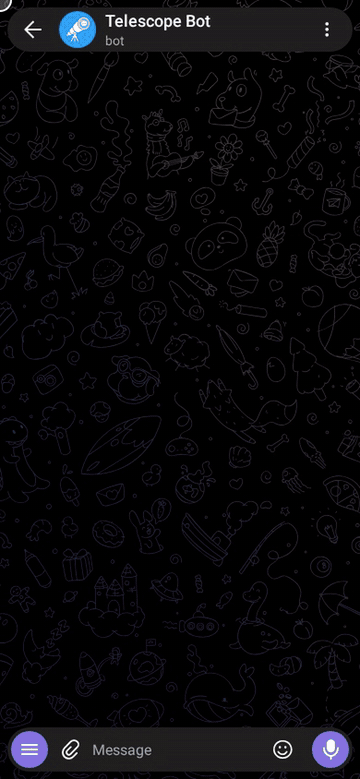
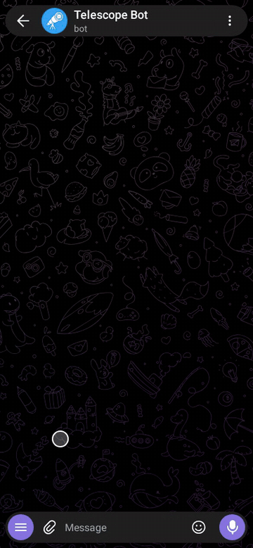
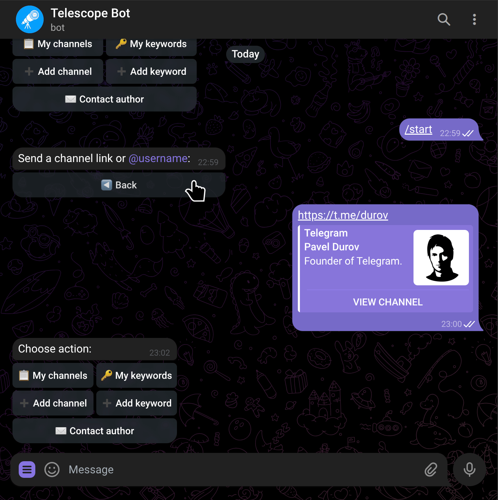
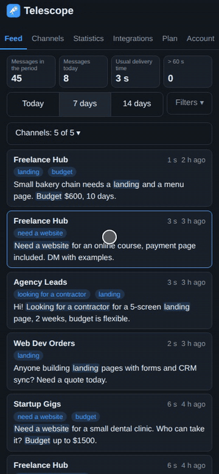
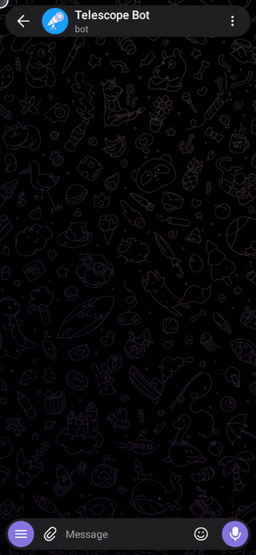

# Telescope

**Keyword alerts for public Telegram channels and chats. Add the places you follow and the words you care about, and Telescope sends you a signal when they show up.**

[Try it now: @telescope_one_bot](https://t.me/telescope_one_bot) · [Website](https://nomad4.tech/telescope)

------

## Quick facts

| | |
| --- | --- |
| What it is | A free app that lives in Telegram: a bot for setup and alerts, plus a personal web cabinet (installable on your phone) with your feed, statistics and export |
| Platform | Works in any Telegram client (iOS, Android, Web, Desktop); the cabinet opens in any browser |
| Price | Free · Pro demo on request (paid plans later) |
| Free plan | 2 channels, 50 keywords per user |
| Alerts | Free: usually within a few minutes. Pro: usually within seconds. The time is not guaranteed |
| Languages | English, Russian, Ukrainian |
| Sources | Public channels and chats (no private channels or DMs) |
| Data stored | Your Telegram user ID, your channels and keywords, and a short alert history for your feed (see Privacy) |

------

## What is Telescope?

Telescope follows public Telegram channels and chats for you. When one of your words appears in a new post, it sends you a signal: the word is underlined, and you see the channel, the author and a link to the original post.

Set it up once and get on with your day. Typical jobs: keyword alerts for Telegram channels, tracking mentions of a brand, following a topic, catching a listing or a request before others do.

## How it works

1. **Add the channels and chats you follow** - by `@username` or a `t.me/` link.
2. **Add your words** - single words, phrases, combinations (`looking + apartment`) and exclusions (`-football`).
3. **Get a signal** - a message from the bot with the word, the channel, the author and a link. Open the post in one tap.

## What people use it for

- **Leads and requests** - be first to answer when someone asks for what you sell
- **Real estate and rentals** - see a matching listing as soon as it is posted
- **Deals and marketplaces** - get a signal when the item you want appears
- **Jobs** - catch new vacancies for your skills before the crowd
- **Brand mentions** - hear when people talk about your company, product or competitors
- **Announcements** - follow release notes, launch dates and listings in project channels
- **Research and news** - follow a topic across public sources without reading every post

------

## Features

- 🔔 **Always on** - new posts are checked around the clock; alerts usually arrive within a few minutes, and Pro is usually within seconds

- 🔑 **Smart keyword matching**
  - Single word -> prefix match (`football` matches `footballer`)
  - Number -> exact match (`2026` won't match `20261`)
  - Phrase -> full phrase match (`rent apartment`)
  - Combination -> all words at once, in any order (`looking + apartment` needs both)
  - A comma finds any of the words (`football, hockey`), a plus finds all of them

- 🚫 **Exclude keywords** - put `-` or `!` before a word (`-football`) to skip posts that contain it, even if another keyword matched

- 📡 **Multiple input formats** - add channels by `@username`, `t.me/` link, or web Telegram URL

  

- 🔑 **Keyword management** - add, view, and remove keywords on the fly; a combination like `looking + apartment` counts as one keyword

  

- 🖥️ **Personal cabinet** *(Pro demo)* - a web app with your feed, search, statistics, channels, keywords and export; open it with `/cabinet` and install it on your phone (the recording uses demo data)

  

- 🌐 **Three languages** - English, Russian and Ukrainian

  

- 💬 **In-app feedback** - report a bug or leave feedback right from the bot menu, no need to leave the chat

- 🗑️ **Full data deletion** - `/deletedata` removes everything, no questions asked

------

## FAQ

**Is there a bot that notifies me when a keyword appears in a Telegram channel?**
Yes - Telescope does exactly this. Add a channel, add a keyword, and you get an alert when a new post matches.

**How do I track mentions of my brand or product on Telegram?**
Add the channels you care about and your brand name as a keyword - Telescope keeps checking new posts and sends you an alert when one matches.

**What's included in the free tier?**
Up to 2 channels and 50 keywords per user, alerts usually within a few minutes. Pro is available as a free demo on request in the bot: up to 5 channels, unlimited keywords, regular expressions, faster delivery and a personal web cabinet with feed, statistics and export. Paid plans, including integrations with your own apps (Slack, Notion, your own service), will come later.

**Can I monitor a Telegram channel without joining it?**
Yes - Telescope only needs the channel to be public; you don't have to join or be a member.

**Can I monitor private channels or groups?**
No - only public channels, the kind anyone can read without an invite. This is the same restriction every Telegram bot has.

**Can I require several words in the same post?**
Yes - join them with `+`: `looking + apartment` matches only when both words are in the post, in any order. Words separated by a comma work the other way: any one of them is enough. A combination counts as one keyword in your limit.

**Can I exclude certain words from matching?**
Yes - add exclude keywords to filter out matches you don't want, without having to drop the main keyword entirely.

**How fast are alerts?**
On the Free plan alerts usually arrive within a few minutes of a post going live. On Pro they usually arrive within seconds. The time is not guaranteed and can be longer.

**Are keywords case-sensitive?**
No. Matching ignores case and works across English, Russian, and other Unicode scripts.

**Do you store the posts?**
Not as an archive. Post text is checked against your keywords. Short alert previews are kept for a limited time so your feed works, then deleted. You can remove everything at any time with `/deletedata`.

**How do I delete my data?**
Send `/deletedata` in the bot - everything tied to your account is removed immediately.

**Does this work for apartment listings, job postings, or niche marketplace channels?**
Yes - any use case where you want an alert on a keyword in a public channel works: real estate, jobs, deals, brand mentions, news topics, and more.

------

## Plans

|                                     | Free                         | Pro *(demo on request)* | Ultimate *(coming soon)* |
| ----------------------------------- | ---------------------------- | ----------------------- | ------------------------ |
| Channels                            | 2                            | 5                       | More                     |
| Keywords                            | 50                           | Unlimited               | Unlimited                |
| Alerts                              | Usually within a few minutes | Usually within seconds  | Usually within seconds   |
| Regular expressions                 | -                            | ✓                       | ✓                        |
| Cabinet: feed, statistics, export   | Basic                        | ✓                       | ✓                        |
| Integrations (webhooks, your apps)  | -                            | -                       | ✓                        |

------

## Commands

| Command       | Description              |
| ------------- | ------------------------ |
| `/start`      | Main menu                |
| `/help`       | Guide and keyword syntax |
| `/language`   | Switch language (ru/uk/en) |
| `/deletedata` | Delete all your data     |
| `/cabinet`    | Personal cabinet link (Pro demo) |

------

## What's new

- **2026-10-15** - The word that triggered an alert is underlined in the text. A channel we cannot read under Telegram rules or the law is marked "not served" in the bot and the cabinet.
- **2026-10-14** - Word combinations: join words with `+` to catch only posts that contain all of them (`looking + apartment`). A comma still means any of the words. A combination counts as one keyword.
- **2026-10-13** - Alerts show who wrote the message (the name links to the profile when it is public) and the channel title is a link to the channel.
- **2026-10-10** - Free plan: 2 channels and 50 keywords.
- **2026-10-07** - Personal web cabinet (feed, statistics, channels, keywords, export) and the Pro demo on request; the bot and the cabinet speak Ukrainian too.

The same list, with older entries, is in the Updates section of the [website](https://nomad4.tech/telescope).

------

## Tech

Built with:

- **Java 17** + **Spring Boot**
- **PostgreSQL** - user data and channel state
- **[telegrambot4j](https://github.com/nomad4tech/telegrambot4j)** - my own open-source Java library for Telegram bots
- **[heartbeat4j](https://github.com/nomad4tech/heartbeat4j)** - my own open-source health-check library, used to catch background monitoring loops that silently stop ticking
- Custom Telegram API layer for channel monitoring

> The code is closed-source, but `telegrambot4j` and `heartbeat4j` - the libraries powering this - are open and available on GitHub

------

## Privacy

Telescope stores: your Telegram user ID, your list of channels and## Privacy

Telescope stores your Telegram user ID, your channels and keywords, and a short history of your alerts for a limited time. It does not keep an archive of posts. Use `/deletedata` to remove everything at any time.

e-Bot-05-03)

------

## Support

Found a bug or have a feature request? Use the **💬 Contact support** button right in the bot, or reach out directly: [@nomad4tech](https://t.me/nomad4tech)

------

Made by [@nomad4tech](https://github.com/nomad4tech) · Powered by [telegrambot4j](https://github.com/nomad4tech/telegrambot4j) and [heartbeat4j](https://github.com/nomad4tech/heartbeat4j)